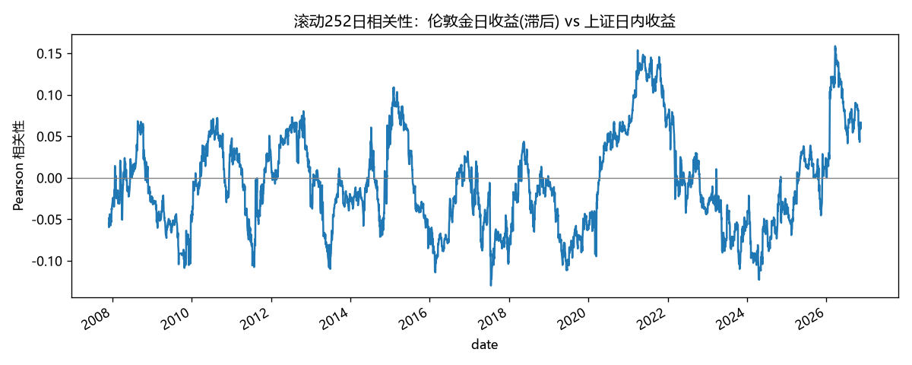
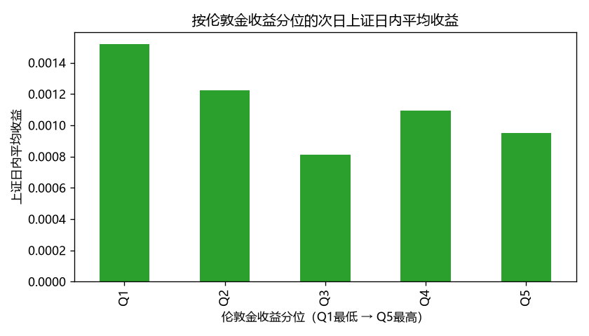

# 黄金-上证日线关系研究（2026-11-14）

- 样本：2006-11-16 ~ 2026-11-13，共 4831 个交易日
- 特征口径：**滞后一日**伦敦金 close-to-close 收益（日线代理，非精确隔夜窗；精确口径见分钟回测）

## 全样本

- 相关性（滞后金收益 vs 上证日内收益）：**-0.0082**
- OLS：beta = -0.0099（t = -0.57），R² = 0.0001
- 对照（同日金收益，含盘后信息，仅看大小）：corr = 0.0591

## 分位数条件收益（滞后金收益 5 分位 → 次日上证日内平均收益）

| gold_q   |     count |    mean |     std |
|:---------|----------:|--------:|--------:|
| Q1       | 967.00000 | 0.00152 | 0.01409 |
| Q2       | 966.00000 | 0.00123 | 0.01205 |
| Q3       | 966.00000 | 0.00081 | 0.01309 |
| Q4       | 966.00000 | 0.00109 | 0.01300 |
| Q5       | 966.00000 | 0.00095 | 0.01400 |

- 金涨日 vs 金跌日之后的上证日内平均收益：金涨日 +0.00092 / 金跌日 +0.00138

## 逐年相关性

|      year |        n |    corr |    beta |   sse_intraday_mean |
|----------:|---------:|--------:|--------:|--------------------:|
| 2006.0000 |  32.0000 | -0.1652 | -0.2915 |              0.0109 |
| 2007.0000 | 242.0000 | -0.0412 | -0.0798 |              0.0032 |
| 2008.0000 | 246.0000 | -0.0284 | -0.0375 |             -0.0018 |
| 2009.0000 | 231.0000 | -0.0058 | -0.0083 |              0.0031 |
| 2010.0000 | 242.0000 |  0.0218 |  0.0292 |              0.0005 |
| 2011.0000 | 243.0000 |  0.0235 |  0.0202 |              0.0004 |
| 2012.0000 | 243.0000 | -0.0161 | -0.0186 |              0.0011 |
| 2013.0000 | 238.0000 | -0.0207 | -0.0166 |              0.0005 |
| 2014.0000 | 245.0000 |  0.0451 |  0.0514 |              0.0023 |
| 2015.0000 | 244.0000 | -0.0700 | -0.1735 |              0.0029 |
| 2016.0000 | 244.0000 | -0.0019 | -0.0027 |              0.0010 |
| 2017.0000 | 244.0000 | -0.0837 | -0.0689 |              0.0014 |
| 2018.0000 | 243.0000 | -0.0087 | -0.0159 |              0.0004 |
| 2019.0000 | 242.0000 | -0.0498 | -0.0693 |              0.0009 |
| 2020.0000 | 241.0000 |  0.0583 |  0.0509 |              0.0012 |
| 2021.0000 | 242.0000 |  0.0700 |  0.0710 |              0.0009 |
| 2022.0000 | 241.0000 | -0.0411 | -0.0441 |              0.0002 |
| 2023.0000 | 240.0000 | -0.0431 | -0.0374 |             -0.0001 |
| 2024.0000 | 240.0000 | -0.0216 | -0.0264 |              0.0009 |
| 2025.0000 | 241.0000 |  0.0033 |  0.0020 |              0.0013 |
| 2026.0000 | 207.0000 |  0.0774 |  0.0330 |              0.0009 |

- 相关性为正的年份 7 个 / 为负 14 个（21 个有效年份，符号一致性 67%）

## 波动率 regime

| vol_r   |         n |    corr |   cond_mean |
|:--------|----------:|--------:|------------:|
| 低波动     | 1604.0000 | -0.0495 |     -0.0002 |
| 中波动     | 1604.0000 | -0.0096 |      0.0001 |
| 高波动     | 1604.0000 |  0.0061 |     -0.0003 |

## 图

## 诚实地说明

- 日线口径是**近似**：日线金收益覆盖整个 24h，不是精确的「上证 15:00 → 09:30」隔夜窗口；精确口径在分钟数据积累后由 minute_backtest 给出
- 若 |corr| 长期 < 0.05，说明该信号强度不足以独立交易，建议加入对照变量（USD/CNH、富时A50期货、隔夜美股）或直接放弃
- 本报告不构成投资建议